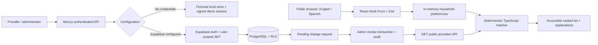
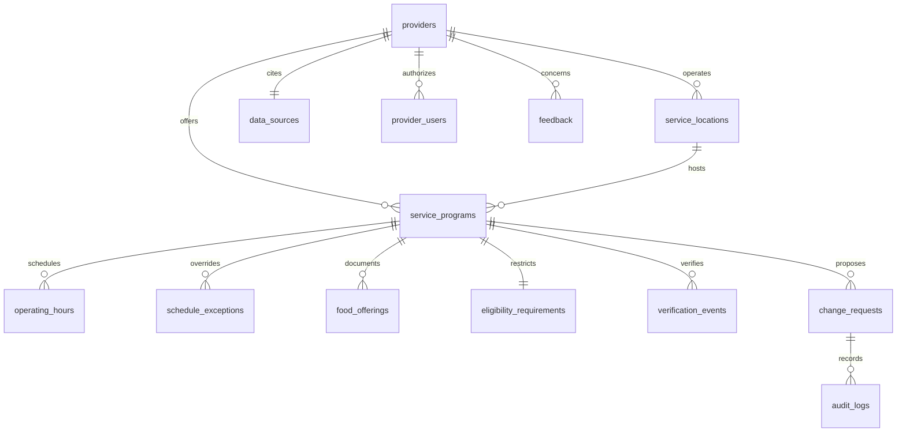

# Technical walkthrough

## System



Public household preferences never go to a server. Providers never receive household profiles. Authentication is separate from anonymous search. The server verifies the session on every privileged request; the database independently verifies membership/administrator rights. No service-role key is used by the app.

## Data relationships



The SQL view serializes normalized rows into the reusable `Provider`/`ServiceProgram` matching contract. `Provider.id` represents a service program in Supabase mode. Organization membership refers to the parent provider. Schedules use half-open intervals `[start,end)`, weekday Monday=0, local minutes since midnight. Exceptional closures use local calendar dates. Verification/update timestamps use UTC (`timestamptz`). Known-empty schedules differ from missing schedules; null offerings differ from documented food categories.

## Algorithm contract and pseudocode

Input: validated `HouseholdPreferences`, an array of `Provider`, an explicit evaluation time, configurable nonnegative factor weights. Output: immutable `MatchResult[]` with constraint states, numeric fit/confidence, category, reasons, freshness, and labeled straight-line distance when possible.

```text
VALIDATE household, normalize defaults at the form boundary
FOR EACH service:
  FOR EACH selected factor:
    evaluate compatible / incompatible / unknown
    preserve whether it is a hard requirement
  schedule := any pickup interval overlapping household availability
              on a nonclosed date within the next 7 local calendar dates
              (clip today's interval to current local time)
  travel := unknown unless a reliable matching-mode estimate is <= 24h old
  food := evaluate documented options and require a jointly usable option
          for hard storage, equipment and dietary requirements
  eligibility := compatible only if explicitly unrestricted; otherwise unknown
  score, confidence := weighted known compatibility and data coverage
  IF a hard factor is incompatible: unsuitable
  ELSE IF any active factor unknown OR data stale OR score < 80: possible
  ELSE: strong
  map exact evaluation codes to bilingual explanation templates
SORT by category, score descending, confidence descending, stable program ID
```

These are initial product defaults, not competition judging weights:

| Factor       | Weight | Hard when selected?                                               |
| ------------ | -----: | ----------------------------------------------------------------- |
| Schedule     |     30 | Yes                                                               |
| Journey time |     25 | Yes                                                               |
| Storage      |     20 | Yes when limited/no refrigeration or shelf-stable selected        |
| Cooking      |     15 | Yes when equipment supplied                                       |
| Diet         |     10 | Only if strict requirement selected                               |
| Eligibility  |      0 | Never considered confirmed without documented unrestricted status |

Let `A` be active weighted factors, `K` known factors, and `C` compatible factors. Unknowns are excluded from both the known-fit numerator and denominator:

```text
knownFit = 100 × Σ(weight of C) / Σ(weight of K)
informationConfidence = 100 × Σ(weight of K) / Σ(weight of A)
```

No known denominator gives score=0 and the interface displays “not enough information,” not a zero-percent suitability claim. Round once to the nearest integer for display. Unselected factors are inactive and excluded. Known eligibility restrictions remain unknown because sensitive eligibility traits are intentionally not collected. Eligibility has no numeric weight, but unknown eligibility still prevents strong classification.

Example: Tuesday afternoon availability, no cooking equipment, no refrigeration, no diet preference. Garden Table satisfies schedule (30), storage (20), cooking (15); routing is unknown (25). Fit=65/65=100%; confidence=65/90=72%. It remains a possible match because routing and independent verification are missing. Community Kitchen conflicts with that Tuesday schedule and is unsuitable even if its food options fit. The example is fictional.

## Uncertainty and difficult cases

- No overlap at touching endpoints; one minute of overlap is accepted in the reference algorithm. A minimum visit duration is a useful student improvement.
- A single food offering must satisfy all hard food constraints together. One shelf-stable food that needs a stove plus one cold ready-to-eat food does not solve a no-refrigeration/no-equipment household. A separate zero-weight combination constraint blocks the match without counting an individual factor twice; even a 100% known-factor score cannot override this conflict.
- Partial/unknown storage, absent offerings, and unverified dietary statements cannot be treated as confirmation.
- Stale or unverified listings remain possible even when their known-fit score is 100%. Confidence measures information coverage, **not** probability, food availability, or data accuracy. Freshness is a separate rule and badge.
- Schedule exceptions close whole local dates; custom exceptional opening hours are a future extension. Split overnight schedules into two day intervals.
- `Intl.DateTimeFormat` uses New York local days safely around DST; no browser timezone assumptions.
- No straight-line speed conversion or fabricated transit times. Travel-provider integrations must supply mode, reliability, timestamp, the exact household origin and verified service destination, and actual route estimates. Estimates for a different origin or destination are unknown.
- Other-diet free text is retained only in page memory and evaluated as unknown; no automatic interpretation or AI inference.

## Complexity

With `N` programs, `A` household intervals, `H` service intervals, `X` closures, and `F` offerings per service: the reference implementation costs `O(N × (7 × (X + A×H) + F) + N log N)`; results take `O(N)` memory plus input-sized explanations. Small local datasets favor explicit readable loops. For national expansion, filter by region in SQL and index interval/day lookups; the matcher itself stays independent of city and storage backend.

## Security and testing

See [SECURITY.md](SECURITY.md), [TESTING.md](TESTING.md), and the migration comments. Core algorithm reimplementation is student-owned; this file documents a reference rather than claiming student authorship.
